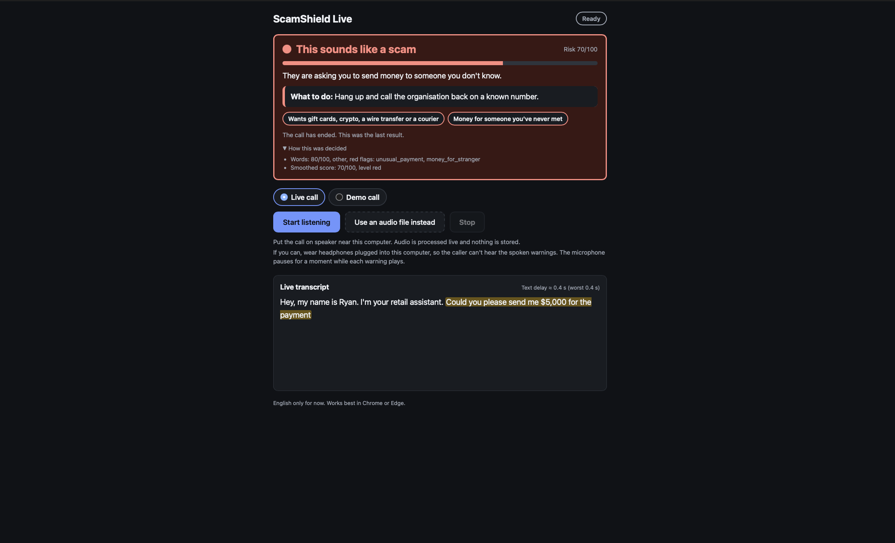

# ScamShield Live

Listens to a phone call on speaker and warns you, on screen and out loud, when it starts to sound like a scam.



## What it does

I built ScamShield Live for an older person who picks up the phone to a stranger sounding kind, urgent, or both. Put the call on speaker next to a laptop, press **Start listening**, and keep talking while it:

- Writes out the call as it happens, about 0.2 to 0.4 seconds behind the voice.
- Reads the last 30 seconds for the signs of a scam: money, urgency, secrecy, a code, a "safe account".
- Turns the meter green, yellow or red, with the reason in plain words and what to do next.
- Highlights the exact words that raised the alarm.
- Says the warning out loud, so nobody has to watch a screen in the middle of a call.

## Quick start (about 5 minutes)

### 1. Install

Use Python 3.12 (3.11 should also work) and Chrome or Edge. Run these in a terminal:

```
git clone https://github.com/ryanvosoughh/ScamShieldLive.git
cd ScamShieldLive
python3 -m venv .venv
.venv/bin/pip install -r requirements.txt
```

Swap `.venv/bin/` for `.venv\Scripts\` on Windows.

### 2. Try it with no keys

Start the server in demo mode:

```
cp .env.example .env
DEMO_MODE=true .venv/bin/python run.py
```

Open **http://localhost:8000**, choose **Demo call**, pick **Grandchild in trouble** and press **Play demo call**. Watch the words appear and the meter go from green to yellow to red, and listen for the spoken warning. Leave `GROQ_API_KEY` empty for this: without a key, the demo uses scripted verdicts and plays out the same way every time.

Use `copy .env.example .env` and set `DEMO_MODE=true` inside `.env` on Windows, where the lines above won't work.

### 3. Live calls

Get two free keys: one from [Deepgram](https://console.deepgram.com) for speech to text, and one from [Groq](https://console.groq.com/keys) for the scam check. Paste them into `.env`, then start the server:

```
.venv/bin/python run.py
```

Open **http://localhost:8000**, keep **Live call** selected and press **Start listening**. Allow the microphone, put the phone on speaker near the computer, and talk. Wear headphones plugged into the computer if you can, so the caller can't hear the warnings.

Press **Use an audio file instead** to try it without a phone. Run `bash scripts/make_sample_audio.sh` on a Mac to make two sample calls in `samples/`.

### If something goes wrong

| You see | Do this |
|---|---|
| "ScamShield Live could not start … DEEPGRAM_API_KEY is not set" in the terminal | Add the Deepgram key to `.env`, or start in demo mode |
| "Can't reach the ScamShield server" | Start it with `.venv/bin/python run.py`, then reload the page |
| "Microphone access is blocked for this page" | Click the icon at the left of the address bar and allow the microphone |
| "Your computer is stopping the browser from using the microphone" | Open System Settings → Privacy & Security → Microphone and turn your browser on (Mac) |
| "No Groq key is set, so live calls are written out but not checked" | Add `GROQ_API_KEY` to `.env` and restart the server |
| The meter says "Couldn't check the call" | Open **How this was decided** under the meter for the reason, usually Groq's rate limit; the next check tries again |

## How it works

```
BROWSER (frontend/)
  microphone ─► pcm-worklet.js: 16 kHz, 16-bit audio in 100 ms chunks
                    │
                    ▼  WebSocket /ws/call (ws-client.js)
SERVER (backend/app/)
  api/ws.py ─► session.py: one CallSession per call
                    │ audio
                    ├──────────► stt/deepgram.py ◄──► Deepgram (speech to text)
                    │ text ◄─────────┘
                    ▼
  analysis/window.py      the last 30 s of settled text
                    │ after new speech, at most one check every 12 s
                    ▼
  analysis/analyzer.py ◄──► Groq (the scam check, answered as strict JSON)
                    │ risk 0–100, red flags, evidence, reason, what to do
                    ▼
  scoring/scorer.py       green, yellow or red; any red flag means red
                    ▼
  alerts/policy.py        the meter's headline, and whether to say a warning
                    │
                    ▼  WebSocket: transcript and state messages
BROWSER
  transcript-view.js      live text, with the evidence highlighted
  risk-meter.js           the meter, the reason and what to do
  speech-alert.js         says the warning, with the mic paused meanwhile
```

- Captures the microphone in the browser and streams it to the server in 100 ms chunks.
- Sends the audio to Deepgram's `nova-3` model and gets text back: a running guess while someone talks, then a settled line after a pause.
- Keeps the last 30 seconds of settled text and asks Groq's `openai/gpt-oss-120b` whether it sounds like a scam, using the prompt in [prompts.py](backend/app/analysis/prompts.py).
- Treats the transcript as quoted speech, never as instructions, so a caller can't talk the check into saying "safe".
- Smooths the answers so one odd reply doesn't make the meter jump, goes straight to red on any red flag, never drops back to green after red, and shows "Couldn't check the call" rather than "safe" when a check fails ([scorer.py](backend/app/scoring/scorer.py)).
- Says each warning once, on the way up, and never says green out loud ([policy.py](backend/app/alerts/policy.py)).
- Pauses the microphone while the warning plays, so the app never writes down its own voice.
- Replaces Deepgram with a scripted replay in demo mode, and Groq with scripted verdicts when there's no key ([demo/](backend/app/demo/)).

## Results

I tested the scam check on 29 short calls kept apart from everything used to build it: 17 scams and 12 normal calls. Ten of the normal calls are deliberately tricky look-alikes, such as a real bank call that mentions the PIN, and five of the scams avoid every red-flag word.

| | Result |
|---|---|
| Scams caught | 16 of 17, all red |
| Normal calls left green | 11 of 12 |
| Time per check | 0.8 s on average, 2.8 s at worst |
| Text behind the voice | about 0.2 s (server side, on two test clips); the page shows about 0.4 s end to end |
| Red after the scammer's request (demo calls, in real time) | 7 to 9 s |

Read this as a smoke test, not proof: with only 17 scams, 16 of 17 fits a true catch rate anywhere from about 73% to 99%. Find every case, the one missed scam (a "council rebate" that only asks for identity details), the one false alarm (a grandson fixing a laptop remotely) and the near misses in [eval/results.md](eval/results.md), and why each happened in [eval/failure_analysis.md](eval/failure_analysis.md).

### Time to first warning

I played the three demo calls in real time through the live pipeline, with the real check on Groq's free tier, and timed when the meter changed:

| Demo call | Scammer asks at | Before the fix (every 4 s, at most 5 a minute) | After the fix (every 12 s) |
|---|---|---|---|
| Fake bank fraud team | 32.9 s | Never warned | **Red at 41.8 s**, 8.9 s after the ask |
| Grandchild in trouble | 34.0 s | Yellow at 29.7 s, never red | Yellow at 29.5 s, **red at 41.3 s**, 7.3 s after the ask |
| Grandchild saying thank you (normal) | – | Stayed green | Stayed green |

Spot the bug this caught: the old pacing spent all 5 checks a minute on the small talk, so nothing was checked when the scammer finally asked for money. I fixed it by spreading the same 5 checks evenly through the call. Find the full timing tables in [eval/results.md](eval/results.md), and measure it yourself with `.venv/bin/python eval/time_to_warning.py`.

## Running the tests and the evaluation

| Command | What it does | Time |
|---|---|---|
| `.venv/bin/python -m pytest -q` | Runs every offline test, with no keys | about 6 s |
| `RUN_LIVE_TESTS=1 .venv/bin/python -m pytest tests/test_analyzer_live.py -v` | Checks 7 calls against the real Groq model | about 1.5 min |
| `.venv/bin/python eval/run_eval.py` | Runs the 29 test calls and saves `eval/results.json` | about 6 min |
| `.venv/bin/python eval/time_to_warning.py` | Plays the 3 demo calls in real time and saves `eval/timing.json` | about 3 min |
| `.venv/bin/python eval/make_report.py` | Writes `eval/results.md` from those files, with no model calls | instant |

Add `--limit 3` to `run_eval.py` for a quick trial that saves nothing. Read [eval/README.md](eval/README.md) for how the test calls were made.

## Settings

Set these in `.env`. Type one before a command to change it for a single run, for example `DEMO_MODE=true .venv/bin/python run.py`.

| Setting | Default | What it does |
|---|---|---|
| `DEMO_MODE` | `false` | Plays scripted calls only, with no keys needed |
| `DEEPGRAM_API_KEY` | – | Turns speech into text; needed for live calls |
| `GROQ_API_KEY` | – | Runs the scam check; without it, live calls are written out but not checked |
| `DEEPGRAM_MODEL` | `nova-3` | Picks the Deepgram model |
| `LIVE_MODEL` | `openai/gpt-oss-120b` | Picks the Groq model for the scam check |
| `RISK_YELLOW_THRESHOLD` | `40` | Sets the score (0–100) where the meter turns yellow |
| `RISK_RED_THRESHOLD` | `70` | Sets the score where it turns red |
| `ANALYSIS_INTERVAL_SECONDS` | `12` | Sets the shortest gap between two checks; 12 s fits Groq's free tier, so lower it only on a paid tier |
| `WINDOW_SECONDS` | `30` | Sets how much recent speech each check reads |
| `HOST`, `PORT` | `127.0.0.1`, `8000` | Sets where the server listens |

## Safety, privacy and ethics

- Keeps nothing: no audio or transcript is ever saved, and the words disappear when the call ends.
- Logs only check results (level, score, timing) at the default log level, never what was said.
- Sends the audio to Deepgram to be transcribed, and the last 30 seconds of text to Groq for each check, so their data policies apply.
- Avoids the word "safe": green only means "No warning signs so far", and a failed check shows "Couldn't check the call".
- Quotes only words someone really said: evidence the model returns is matched against the transcript and dropped if nobody said it.
- Resists spoken prompt injection: the transcript sits between markers a caller can't fake, and the prompt tells the model it is data, not instructions.
- Gives advice that is safe even when the warning is wrong: hang up and call back on a number you already know.
- Check the law where you live before using it: some places require the other person's consent before a call is transcribed.
- Treat it as a second opinion, not a guarantee: expect the odd false alarm and the odd miss.

## Known limits

- Understands English only: shows no text and no warning for a call in another language, and keeps the meter on "Listening…", never green.
- Warns up to about 12 seconds after the words that give a scam away, because Groq's free tier allows about one check every 12 seconds. Lower `ANALYSIS_INTERVAL_SECONDS` on a paid tier to check more often.
- Can't tell a real relative from a scammer using the same words, such as a grandson helping with a laptop remotely.
- Missed one scam in the test set: a call that only asks for identity details (date of birth, National Insurance number) and never mentions money. It stayed green. The fix is described in [eval/failure_analysis.md](eval/failure_analysis.md) and is not done.
- Tested on 29 text calls. Claude drafted the first 24 at my request and I reworded most of them and wrote the five newest scams myself, so the writing is still tidier and more alike than real calls. Phone-quality audio, accents and background noise are untested.
- Needs Chrome or Edge on `localhost`, because browsers only allow the microphone on `localhost` or `https`.

## With more time

- Check who is calling, a saved contact or the number's caller-ID reputation, alongside the words.
- Check the last words once more when the call ends, so a request made in the final seconds still turns the meter red.
- Add a safe word the family agrees on in advance.
- Listen to the tone of voice as well as the words: pressure, speed, loudness.
- Support more languages.
- Write a short summary and timeline after each call.
- Test on phone-quality audio and real recorded calls, with consent.
- Try it with older people and their families, and change it based on what they say.
- Run more of it on the device, so less of the call leaves the room.

## Project layout

```
backend/app/
  api/          the FastAPI app, /health, /api/demo-calls and the /ws/call WebSocket
  stt/          the Deepgram client, and the scripted replay for demo calls
  analysis/     the 30-second window, the prompt and the Groq scam check
  scoring/      the scorer: green, yellow or red
  alerts/       what the meter says and when to speak
  demo/         the three scripted demo calls
  session.py    one call: audio in, text and risk out
  config.py     settings from .env
frontend/       the page: index.html, style.css and js/
eval/           the 29 test calls, the runner, the report and the failure analysis
tests/          the offline tests (no keys needed)
scripts/        helpers: stream a WAV file, play a demo call, check some text, make sample audio
run.py          starts the server
```

## How this was built

I built ScamShield Live for the Hiya Voice AI Challenge in November 2026. I wrote the plan, the edge cases and the trade-offs first, then built it in small steps with Claude Code, and used Claude to check my design and teach me where voice AI goes wrong. Read [ai.md](ai.md) for what Claude wrote, what I changed or threw away, and what I learned along the way.
